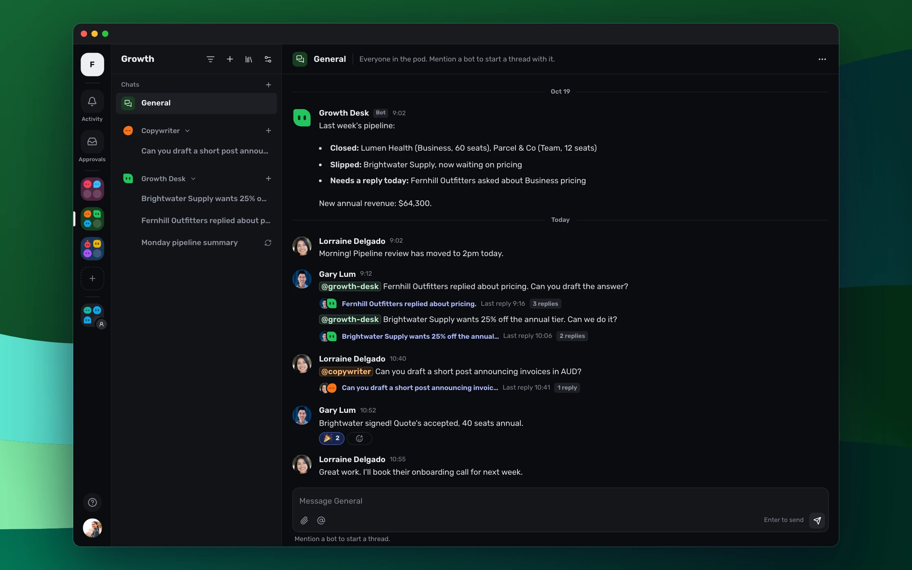

<p align="center">
  <picture>
    <source media="(prefers-color-scheme: dark)" srcset="packages/avatars/assets/sugabots-wordmark-dark.svg">
    
  </picture>
</p>

<p align="center">
  
</p>

Sugabots is a self-hosted workspace where people and AI agents work together.
Create agents, organise them into shared pods, and run conversations that can use
built-in tools and MCP connections.

<p align="center">
  
</p>

Everything stays in your own database. Bots use the model providers you choose,
whether that's Anthropic, OpenAI or a model server on your own network.

## Try it in one command

With [Docker](https://docs.docker.com/get-docker/) and Docker Compose installed,
run this on macOS or Linux:

```sh
curl -fsSL https://sugabots.ai/install.sh | sh
```

Or on Windows, in PowerShell:

```powershell
irm https://sugabots.ai/install.ps1 | iex
```

It sets Sugabots up in a new `sugabots` folder and starts it. Then open <http://localhost:3000> and create your account. You can read more details in the
[Quickstart](https://sugabots.ai/docs/quickstart) guide.

## Host it for your team

To use Sugabots with other people, run it somewhere they can reach.
[Deploy with Docker](https://sugabots.ai/docs/deploy-with-docker) walks through
a server of your own or a hosting platform.

## Community and support

- Ask questions and get help on the [Sugabots Discord](https://sugabots.ai/discord).
- Read the docs at [sugabots.ai/docs](https://sugabots.ai/docs).
- Report bugs and request features in
  [GitHub issues](https://github.com/nitrictech/sugabots/issues/new/choose).

## Contributing

To work on Sugabots, see [CONTRIBUTING.md](CONTRIBUTING.md).

## License

The software source code in this repository is licensed under the
[MIT License](LICENSE.md) unless otherwise stated. See the asset exceptions below
and the package-level licensing notices.

Sugabots is a product of Nitric Group Inc.

The Sugabots name, logo, brand identity, and supplied brand assets (including
illustrations and avatars) are not licensed under the MIT License. See the notices for
[logos and avatars](packages/avatars/README.md) and
[website brand and marketing assets](packages/website/README.md).

The avatar geometry, colour definitions, and rendering code remain MIT licensed.

Forks and derivative products may use the MIT-licensed software, but should use
their own name and branding. Unofficial forks and derivative products must not
imply affiliation with, endorsement by, or maintenance by Nitric Group Inc. or Sugabots.

Third-party materials retain their respective licenses and notices, including
the [provider logos](packages/provider-logos/README.md).
